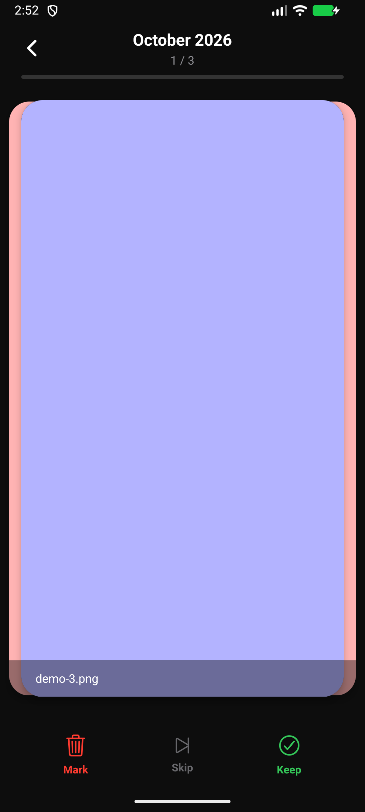
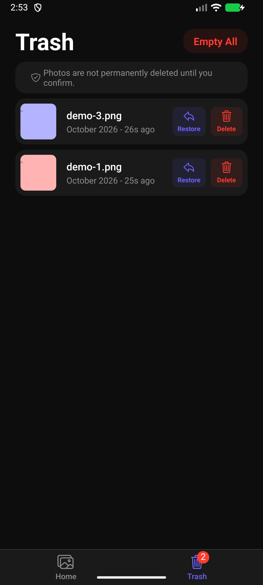
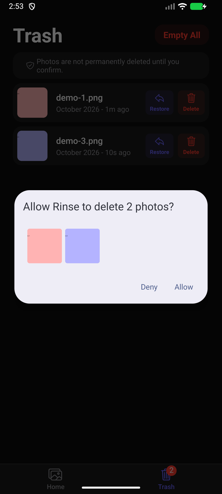
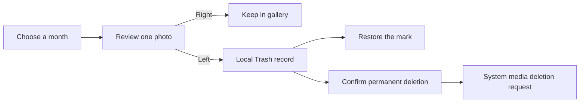
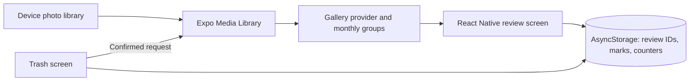

<div align="center">


# Rinse

**A calmer way to review your camera roll, one month at a time.**

Swipe right to keep. Swipe left to mark. Decide what leaves your gallery when you're ready.

[](https://github.com/Muneer320/Rinse/actions/workflows/verify.yml) [](LICENSE) [](package.json)

[**Download Android preview**](https://github.com/Muneer320/Rinse/releases/tag/v1.0.0-preview.3) · [**How it works**](#a-small-decision-for-each-photo) · [**Develop locally**](#develop-locally)

</div>

## A small decision for each photo

A growing gallery can turn a quick tidy-up into a long session of selecting thumbnails. Rinse breaks it into monthly review sessions: see one photo, keep it or mark it, and pick up where you left off. Marked photos wait in a local Trash list so you can reconsider before permanent deletion.

| Review a month | Reconsider in Trash | Confirm with Android |
| :---: | :---: | :---: |
|  |  |  |

*Real Android 16 emulator captures using disposable color-card images. Batch consent passed on the emulator; the physical-phone limitation is recorded below.*

| Make steady progress | Keep a way back | Keep photos on-device |
| --- | --- | --- |
| Monthly groups and saved review sessions | Undo the latest mark for five seconds, or restore older marks from Trash | Gallery photos and review metadata are not uploaded; local records use AsyncStorage |

> [!IMPORTANT]
> **A left swipe marks a photo; it does not delete it.** Permanent deletion requires a separate confirmation and may also require Android's system consent. This is an Android-focused prototype. Batch deletion on the tested physical phone failed with MediaStore `Invalid Uri`; iOS has not been verified. Try it with disposable photos.



The latest left swipe can be undone for five seconds or until the next review choice. Older marked photos can be restored from Trash. Review counters track choices, not reclaimed storage.

## Try the Android preview

1. Open the [preview.3 release](https://github.com/Muneer320/Rinse/releases/tag/v1.0.0-preview.3) and download `rinse-android-preview.apk`. A SHA-256 checksum file is provided alongside it. Android may ask permission to install from the downloading app.
2. Install and open Rinse, grant photo-library access, then choose a month containing disposable test images.
3. Keep or mark a few photos. Open **Trash** to restore marks or try a separately confirmed deletion. A cancelled or failed system request keeps the relevant Trash records.

The signed APK was installed and launched on an Android 16 emulator. A debug build also ran on a physical Android 16 phone with USB Fast Refresh. A Play Store release, public privacy-policy URL and device performance benchmark are not claimed.

## Develop locally

Use Git, Node.js 22.13+ and the Android SDK with an authorized USB-debugging phone or an emulator. Java/native build tooling must be available for Expo's Android build. Install and launch a debug build:

```sh
git clone https://github.com/Muneer320/Rinse.git
cd Rinse
npm ci
npx expo run:android --device
```

Keep the development server running for Fast Refresh while editing JavaScript, TypeScript or styles. Native dependencies, permissions and SDK changes require another native build. The signed preview APK is a release build and does not receive local Fast Refresh updates.

<details>
<summary><strong>Later development sessions and optional cloud builds</strong></summary>

Start Metro with `npx expo start --dev-client` and reopen the installed debug app. The [Expo development-build guide](https://docs.expo.dev/develop/development-builds/introduction/) explains the optional `expo-dev-client` launcher and rebuild workflow. Expo Go does not use Rinse's own native permission configuration.

For an installable cloud-built preview, install the EAS CLI, sign in and run `eas build --platform android --profile preview`. This path requires an Expo account and was not re-run for this documentation update. The production profile creates an Android App Bundle for store submission; build numbers are configured in `app.json`, and the production EAS profile increments them. No store submission is implied.

</details>

## Under the swipe



Expo SDK 57, React Native, TypeScript and Expo Router provide the app shell. Gallery/session providers coordinate review state; the system media library owns photo files. Uninstalling Rinse removes its local review/Trash records, not the photos in the gallery. Expo development and EAS build services are separate from gallery storage. See [Privacy](PRIVACY.md).

<details>
<summary><strong>Storage behavior, incomplete features and dependency limits</strong></summary>

Rinse stores reviewed photo IDs, Trash IDs and review counters in AsyncStorage on the device. It uses those IDs when resuming so newly added photos are not skipped. Photo files stay in the system gallery until the user confirms **Delete Forever** or **Empty All**. Empty All sends one batch delete request and keeps Trash records if the request fails. A cancelled system delete is not retried automatically. The month list fetches lightweight media metadata first; full photo data is loaded when a month is opened. Photos without capture dates use their modification dates. Access is limited to photos, though the operating system may offer limited library access.

The counters represent review choices, not reclaimed storage. Rinse does not measure file size or show a space saved figure. It does not automatically purge Trash after 30 days; that item in the [original PRD](docs/PRD.md) remains a future idea because silent permanent deletion needs explicit product decisions and native testing. Large libraries still require a complete metadata scan before the month list is shown.

The Android preview is a prototype. Transitive advisories remain in the Expo 57, Metro and router dependency tree; inspect `npm audit` before distribution. No Play Store submission, public privacy policy URL or device performance benchmark is claimed. See [Privacy](PRIVACY.md) and [Architecture](docs/Architecture.md).

</details>

<details>
<summary><strong>Tests and the existing verification record</strong></summary>

```sh
npm test
npx tsc --noEmit
npx expo-doctor
npx expo export --platform android
```

The tests cover consecutive left swipes, persistent Trash records, session resumption after the first swipe and after the gallery changes, and Undo on the last photo. An Android 16 emulator run also verified photo permission, real swipes, process restart, final-photo Undo, completion, Restore, cancelled deletion, single deletion, one batch consent request for two photos, and refreshed gallery counts. It used disposable images. A debug build also launched on a physical Android 16 phone and received live UI edits over USB. Batch deletion on that phone was rejected by Android MediaStore with `Invalid Uri`; that path needs further investigation. iOS has not been verified.

These checks describe the existing verified implementation; this README pass does not rebuild the app or repeat device deletion tests.

</details>

## Guides and contributions

| Understand the app | Explore its origins |
| --- | --- |
| [Architecture](docs/Architecture.md) | [Original product requirements](docs/PRD.md) — includes future ideas |
| [Privacy and local data](PRIVACY.md) | [Editable logo source](assets/logo-mark.svg) |
| [Build profiles](eas.json) | [MIT license](LICENSE) |

Report bugs in [Issues](https://github.com/Muneer320/Rinse/issues), including Android version, permission state and reproduction steps with disposable images. For a focused PR, run the relevant checks above, document native configuration changes and keep personal photos or credentials out of attachments.

Created by [Muneer Alam](https://github.com/Muneer320). Released under [MIT](LICENSE).
